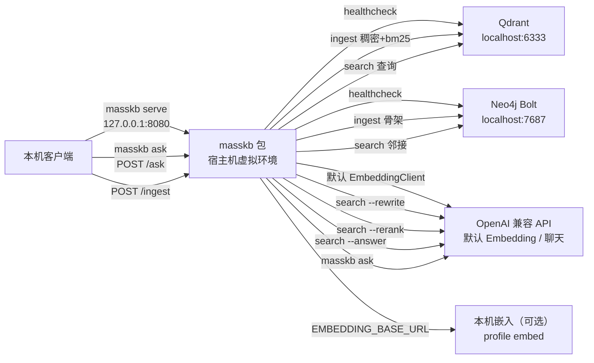

# MassKB

面向海量知识库的智能检索中间件：向量检索、知识图谱与智能代理。

*Intelligent retrieval middleware for large knowledge bases — vector search, knowledge graph, and an agent layer.*

[](https://github.com/bgwealth2027/masskb/actions/workflows/ci.yml)
[](LICENSE)
[](pyproject.toml)

MassKB 是一层检索中间件，目标是把向量检索、知识图谱和智能代理放在同一条调用链上。当前版本是 **0.1.0**。仓库里已有可安装的 Python 包、Qdrant、Neo4j 与应用服务的 Docker Compose、离线单元测试，以及在 `main` 上运行的 GitHub Actions。UTF-8 的 `.txt` / `.md` 可以在本地切成稳定分块。`masskb ingest` 把这些分块写入 Qdrant，并在向量写成功后同步 Neo4j 文档骨架；`--dry-run` 只做预览。`masskb search` 默认用同一套 Embedding 模型做近邻检索，把命中的原文打成 JSON，并附上前后分块 id。加上 `--hybrid` 时，把稠密名次和 Qdrant 稀疏向量 `bm25` 的名次在进程内融合；加上 `--rewrite` 时，用 `LLM_MODEL` 在检索前把查询改写成一条检索文本；加上 `--rerank` 时，用 `LLM_MODEL` 对已经截断的命中做 listwise 重排；加上 `--answer` 时，用 `LLM_MODEL` 根据命中分块生成回答，引用只能来自这些命中的 `chunk_id`。这四个开关默认关闭。加上 `--graph-hops` 时，沿已有的前后分块边和人物或概念提及最多替换 1 条命中，默认关闭。`ingest --entities` 可以把人物和概念提及写入 Neo4j，默认关闭。本机 HTTP 是可选额外依赖：安装 `.[api]` 后，`masskb serve` 提供 `GET /health`、`POST /search`、`POST /ask` 与 `POST /ingest`。`masskb ask` 与 `POST /ask` 提供默认不运行的工具循环。模型最多 3 步，只能调用现有检索和健康检查，再按本轮见过的 `chunk_id` 收束回答。`search` 与 `POST /search` 不变。没有会话或鉴权。`POST /ingest` 读取服务端路径，切分和写入与 `masskb ingest` 相同。安装本包后，`MassKB` 可以调用已经启动的 `masskb serve`。客户端不导入检索管线，不启动服务。`MassKB.ingest()` 调用 `POST /ingest`。

## 目录

- [项目简介](#项目简介)
- [架构](#架构)
- [当前状态](#当前状态)
- [安装与运行](#安装与运行)
- [配置](#配置)
- [项目结构](#项目结构)
- [测试与持续集成](#测试与持续集成)
- [许可证](#许可证)

## 项目简介

本仓库交付的是 Python 库、命令行，以及依赖服务的 Compose 文件。各组成部分的设计职责和 0.1.0 的实际范围如下：

| 组成部分 | 目标职责 | 本仓库里的落点 |
|----------|----------|----------------|
| 向量检索 | 对文本做语义相似度查找，并可选地融合关键字名次、再用大模型重排 | `VectorStore` 连接 Qdrant。入库写入 `masskb_chunks` 的未命名余弦向量，以及名为 `bm25` 的稀疏向量。默认 `search` 仍是余弦近邻；`--hybrid` 在进程内做倒数排名融合。`--rerank` 在截断之后用 `LLM_MODEL` 做 listwise 重排，默认关闭，不增加依赖 |
| 知识图谱 | 保存文档与分块的骨架，并读取前后邻；可选地记下人物和概念提及，并在检索时沿这些边做有界扩展 | `GraphStore` 连接 Neo4j。健康检查只做 Bolt 连通性；入库 MERGE `Document` / `Chunk`，检索读取一跳 `NEXT_CHUNK`。`ingest --entities` 再 MERGE `Person` / `Concept` 和 `MENTIONS`。`search --graph-hops` 只读这些已有边，默认关闭 |
| 带引用的回答 | 用大模型根据命中分块组织回答 | `search --answer` 调用 `LLM_MODEL`。引用必须是本次命中的 `chunk_id`。默认关闭。提示词仍使用用户原文。没有工具调用循环 |
| 本机 HTTP | 把健康检查、检索、工具循环和路径入库暴露到本机 | 可选 extra `[api]`。`masskb serve` 默认监听 `127.0.0.1:8080`，调用现有的 `healthcheck()`、`search()`、`ask()` 与 `ingest()`。`POST /ingest` 读取服务端上的路径。Compose 的应用服务传入 `--host 0.0.0.0`，并把端口发布到宿主机的 `127.0.0.1:8080`。核心安装不含 FastAPI。没有鉴权，也没有上传接口 |
| Python 客户端 | 调用已经启动的本机 HTTP | `MassKB` 在核心安装里，使用已有的 `httpx`。覆盖 `GET /health`、`POST /search`、`POST /ask`、`POST /ingest`。不导入 `RetrievalPipeline`。FastAPI 仍只在 `[api]` |

向量由 OpenAI 兼容的 Embedding API 生成。核心依赖是 `qdrant-client`、`neo4j`、`openai`、`python-dotenv`、`httpx`、`pydantic`。可选 extra `[api]` 才安装 `fastapi` 与 `uvicorn`。安装清单里没有 `sentence-transformers`、`torch` 或 `fastembed`。可选嵌入边车单独钉死 `fastembed`，不进入这个安装清单。本地切分不使用这些客户端。

## 架构

### 当前运行时

Docker Compose 启动 Qdrant、Neo4j，以及只跑 `masskb serve` 的应用容器。宿主机虚拟环境仍然可以直接跑 CLI，并访问本机端口。默认时 Embedding 请求发往 `LLM_BASE_URL`（默认 `https://api.openai.com/v1`）。设置 `EMBEDDING_BASE_URL` 后，只有 `EmbeddingClient` 改走该地址；改写、重排、回答、实体抽取和 `ask` 仍使用 `LLM_BASE_URL`。健康检查不调用 Embedding API。`ingest --dry-run` 只在进程内切分本地文件，不访问外部服务。不带 `--dry-run` 的 `ingest` 会请求 Embedding API，把稠密向量和稀疏向量写入同一个 Qdrant 点，再把该文档的骨架写入 Neo4j。加上 `--entities` 时，骨架成功后再按分块请求 `LLM_MODEL`，把人物和概念提及写入 Neo4j。`search` 默认先请求 Embedding API。加上 `--rewrite` 时，先用 `LLM_MODEL` 把查询改写成一条检索文本，再对该文本请求 Embedding；改写失败则仍用原文。然后在 Qdrant 里做近邻查询，并按命中的 `chunk_id` 读取前后邻。默认检索不读取人物和概念。`--graph-hops` 在截成 `top_k` 之后、重排之前，只读 `NEXT_CHUNK` 和 `MENTIONS`，最多替换 1 条命中。`--hybrid` 会再查一次稀疏向量，编码用的是同一条检索文本，并在补邻之前于进程内融合。`--rerank` 在图扩展之后、补邻之前，用 `LLM_MODEL` 做 listwise 重排，提示词仍是用户原文。`--answer` 在补邻之后才请求聊天补全，提示词也仍是用户原文。改写失败时改用原文继续检索。Neo4j、稀疏腿、重排或回答失败时，已经拿到的命中仍然输出。检索不写入 Qdrant。`masskb serve` 在同一进程里提供 `GET /health`、`POST /search`、`POST /ask` 和 `POST /ingest`，默认只绑 `127.0.0.1:8080`。健康检查和检索不写入 Qdrant。`POST /ingest` 读取服务端路径：`dry_run` 只做本地切分，否则调用现有的 `ingest()`。`masskb ask` 与 `POST /ask` 默认不运行；打开后，模型最多 3 步，只能调用现有的 `search()` 和 `healthcheck()`。健康检查、检索、整次 ask 和整次入库共用一把进程锁，调用结束才释放。



| 组件 | 实现 | 说明 |
|------|------|------|
| Qdrant | `qdrant/qdrant:latest` | HTTP `6333`，gRPC `6334`；容器名 `masskb-qdrant` |
| Neo4j 5 | `neo4j:5` | Browser `7474`，Bolt `7687`；容器名 `masskb-neo4j`；Compose 会安装 APOC，业务代码尚未调用 |
| Embedding / LLM | OpenAI 兼容 HTTP API | `EmbeddingClient` 请求 embeddings。默认与聊天共用 `LLM_BASE_URL`。可选 profile `embed` 提供本机 CPU ONNX 嵌入，需单独设置 `EMBEDDING_BASE_URL` 与 `EMBEDDING_DIMENSIONS`。`LLM_MODEL` 用于 `search --rewrite`、`search --answer`、`search --rerank`、`ingest --entities` 和 `masskb ask` |
| 本地切分 | `masskb.ingest` | 空行分段，超长段按字符窗口切开。`ingest` 默认把分块写入 Qdrant；`--dry-run` 只预览 |
| 稀疏编码 | `masskb.sparse` | 进程内把正文编成 `bm25` 稀疏向量。中文用二字组，不另起检索引擎 |
| 编排 | `RetrievalPipeline` | `ingest()` 先写稠密和稀疏向量，再同步文档骨架；`search()` 默认做近邻检索并补前后邻，可选改写、融合、重排和回答；`healthcheck()` 汇总两个数据库的状态；`ask()` 在最多 3 步内调用这两项 |
| 本机 HTTP | `masskb serve` | 可选 extra `[api]`（FastAPI 与 uvicorn）。默认 `127.0.0.1:8080`。进程内一把锁串行调用 `healthcheck()`、`search()`、整次 `ask()` 和整次 `ingest()` |
| Python 客户端 | `MassKB` | 随核心安装提供，不新增依赖。调用已经启动的 `masskb serve`，不导入管线，不启动服务 |
| 部署 | `Dockerfile` 与 `docker-compose.yml` | 服务 `app`（容器名 `masskb-app`，镜像 `masskb-app:local`）只跑 `masskb serve`。可选服务 `embed`（profile `embed`，镜像 `masskb-embed:local`）不在默认 `up` 中。数据卷是 `qdrant_data`、`neo4j_data`、`neo4j_logs`，启用该 profile 时另有 `embed_cache` |

### 目标架构图

设计图放在 [`docs/architecture/`](docs/architecture/README.md)，源文件是 draw.io，可用 [diagrams.net](https://app.diagrams.net/) 打开。这些图描述的是目标形态。应用容器仍只执行 `masskb serve`。HTTP 现为 `GET /health`、`POST /search`、`POST /ask` 与 `POST /ingest`。图中的完整 REST 和独立检索引擎仍未落地。本地嵌入推理已有可选 Compose profile `embed`，默认不启动；图中的 bge-m3 与 GPU 仍是目标。进程内有界工具循环已由 `masskb ask` 落地，只调用现有检索与健康检查。`search --graph-hops` 已能沿文档骨架和人物/概念提及做有界扩展。图中的意图理解分叉、独立图谱工具、别名合并、独立 Agent 服务和完整 SDK 仍是目标。Python 客户端已覆盖这四条路由。`masskb serve` 提供健康检查、检索、`POST /ask` 和路径入库。关键字检索是 Qdrant 稀疏向量，融合在进程内。向量入库、文档骨架与查询以 [当前状态](#当前状态) 为准。

| 文件 | 图名 | 图里有什么 |
|------|------|------------|
| [01-总体架构.drawio](docs/architecture/01-总体架构.drawio) | 总体架构 | 检索层、图谱层、智能层，以及面向集成方的 SDK / REST |
| [02-数据流.drawio](docs/architecture/02-数据流.drawio) | 数据流 | 索引与图谱构建、查询路径。图中向量模型写作 bge-m3；代码默认模型是 `text-embedding-3-small`。可选 profile 的默认模型是 `BAAI/bge-small-zh-v1.5`（512 维） |
| [03-部署架构.drawio](docs/architecture/03-部署架构.drawio) | 部署架构 | Compose 网络含 Qdrant、Neo4j 和应用服务。可选嵌入容器在 profile `embed`，默认 `up` 不启动。应用服务不挂语料卷。图中的 bge-m3 与 GPU 仍是目标 |
| [04-集成与社区.drawio](docs/architecture/04-集成与社区.drawio) | 集成与社区 | 第三方经 SDK / API 集成，以及 Fork → PR → CI → 合并。Python 客户端已覆盖现有四条路由。图中的完整 SDK、多语言 SDK 和完整 REST 仍是目标；`masskb serve` 是本机 HTTP，含一条路径入库。CI 已跑离线测试 |

## 当前状态

仓库里已有核心包、本地文本切分、Qdrant 稠密与稀疏入库、可选的混合检索、查询改写、重排、图扩展和带引用回答、Neo4j 文档骨架、可选的人物与概念提及、可选的本机 HTTP（含路径入库）、默认不运行的有界工具循环、调用这四条路由的 Python 客户端、离线测试和 CI。下表只统计当前代码。

| 能力 | 状态 | 说明 |
|------|------|------|
| 环境配置 | 已实现 | `masskb.config.Settings` 读取仓库根目录 `.env` 与环境变量 |
| Embedding 客户端 | 已实现 | `EmbeddingClient.embed` / `embed_one`。占位 API Key 在走 `LLM_BASE_URL` 时会直接报错。设置 `EMBEDDING_BASE_URL` 后，嵌入不再要求真实 Key。测试里客户端被 mock |
| Qdrant 封装 | 已实现 | 健康检查、建集合、批量 upsert、按 `doc_id` 删除、余弦近邻查询，以及 `bm25` 稀疏槽。查询不创建集合 |
| Neo4j 封装 | 已实现 | 健康检查仍是 `verify_connectivity` 与 `RETURN 1`。另有文档骨架的约束、MERGE、删除、前后邻读取，以及只读的相关分块查询 |
| 健康检查 CLI | 已实现 | `masskb healthcheck`、`python -m masskb`、`scripts/healthcheck.py` |
| 文本切分 | 已实现 | UTF-8 `.txt` / `.md` 切成带稳定 `doc_id`、`chunk_id` 和字符偏移的分块。`masskb ingest --dry-run` 只打印预览，不连接 Qdrant、Neo4j 或 OpenAI |
| 向量入库 | 已实现 | 默认集合 `masskb_chunks`，未命名余弦向量默认 1536 维（`EMBEDDING_DIMENSIONS`），另有稀疏向量 `bm25`（IDF）。写入前探测一次向量维度，不一致则中止且不写。重复运行按 point id 覆盖稠密和稀疏向量，并按 `doc_id` 删除该文档的过期点。每个文档的向量步骤成功后再同步 Neo4j |
| 离线测试与 CI | 已实现 | `tests/` 不连接真实服务；`.github/workflows/ci.yml` 在 `main` 推送和 Pull Request 上运行 |
| 向量检索 | 已实现 | `RetrievalPipeline.search` 与 `masskb search`。默认返回余弦分数、原文、路径、`chunk_id`、字符偏移，以及 `prev_chunk_id` / `next_chunk_id`。集合不存在或没有命中时得到空列表 |
| 混合检索 | 已实现 | `search --hybrid`。稠密与 `bm25` 各取一列名次，在进程内按 RRF（k=60）融合。默认关闭，因此默认的 `score` 仍是余弦相似度 |
| 带引用回答 | 已实现 | `search --answer`。只把命中的 `chunk_id` 和正文送给 `LLM_MODEL`。引用必须是这些 id 的子集。默认关闭。提示词使用用户原文 |
| 文档骨架 | 已实现 | `Document`、`Chunk`、`HAS_CHUNK`、`NEXT_CHUNK`。重复运行使用 MERGE。图中不存正文和向量。架构图里的 Content 对应这里的 `Document` |
| 人物与概念提及 | 已实现 | `ingest --entities` 默认关闭。每个文档的向量和骨架成功后，按分块调用 `LLM_MODEL`。名称必须是该分块正文的子串。`Person.person_id` 与 `Concept.concept_id` 用 MERGE，边是 `MENTIONS`。重复运行替换该文档当前分块上的提及。默认检索不读取这些节点。同一表面形式的别名仍不合并 |
| 图扩展 | 已实现（默认关闭） | `search --graph-hops` 与 `POST /search` 的 `graph_hops`。在截成 `top_k` 之后、重排之前，沿种子的 `NEXT_CHUNK` 和可选 `MENTIONS` 最多替换 1 条命中。`top_k` 为 1 时不替换。图查询或补正文失败时保留向量命中，退出码仍为 0。不调用 APOC，也不在检索时建约束 |
| 重排 | 已实现 | `search --rerank` 默认关闭。在图扩展之后、补邻和回答之前，用 `LLM_MODEL` 做 listwise 重排。成功时 `score_kind` 为 `rerank`，`score` 为 `1/名次`。不新增依赖，也不重排融合前的候选。提示词使用用户原文 |
| 查询改写 | 已实现 | `search --rewrite` 与 `POST /search` 的 `rewrite` 默认关闭。检索前用 `LLM_MODEL` 把查询改写成一条文本，供 embedding 和 bm25 使用。失败则用原文检索，退出码仍为 0。JSON 里的 `query` 始终是用户原文。重排和回答的提示词也使用原文 |
| 本机 HTTP | 已实现 | 可选 extra `[api]`。`masskb serve` 提供 `GET /health`、`POST /search`、`POST /ask` 与 `POST /ingest`。健康检查和检索的响应与 CLI 的健康检查字典和 `search` JSON 一致。写入成功的正文是 `asdict(IngestWriteResult)`；`dry_run` 只切分，不连接 Qdrant、Neo4j 或 OpenAI。默认只绑 `127.0.0.1`，无鉴权。没有上传接口 |
| 应用容器 | 已实现 | `Dockerfile` 与 Compose 服务 `app`。容器内执行 `masskb serve --host 0.0.0.0 --port 8080`，宿主机只发布 `127.0.0.1:8080`。不含嵌入运行时。可选嵌入是旁边的 profile `embed`，不在这个镜像里。不挂载语料卷，容器内入库只能看到该用户可见的路径 |
| 本机嵌入推理 | 已实现（可选，默认关闭） | Compose profile `embed`，镜像 `masskb-embed:local`。CPU ONNX（fastembed），不进入应用镜像，不进入核心依赖。默认不启动。启用后须同时设置模型与维度，并在新集合上重新入库 |
| Agent | 已实现（第一版，默认不运行） | `masskb ask` 与 `POST /ask`。模型在最多 3 步内调用已有的 `search` 与 `healthcheck`，再给出带 `chunk_id` 引用的回答。调用方的 `graph_hops` 会原样传给内部检索。默认不进入 `search`。没有单独的图谱工具、别名合并、会话或多用户 |
| Python 客户端 | 已实现（第一版） | `masskb.client.MassKB` 调用 `GET /health`、`POST /search`、`POST /ask`、`POST /ingest`。与这些 HTTP JSON 一致。不导入 `RetrievalPipeline`。不提供鉴权或会话 |

## 安装与运行

需要 Python 3.10 或更高版本（CI 使用 3.12）以及 Docker Compose。应用容器只跑 `masskb serve`。CLI、入库和离线测试仍在宿主机。本地切分预览不需要启动容器，也不需要 API Key。写入向量和执行检索时需要 Qdrant，以及真实的 `OPENAI_API_KEY` 或已设置的 `EMBEDDING_BASE_URL`。问答、改写、重排、实体抽取和 `ask` 仍需要真实 Key。同步文档骨架和补前后分块时还需要 Neo4j；检索在 Neo4j 不可用时仍返回向量命中。

### 1. 克隆

```bash
git clone https://github.com/bgwealth2027/masskb.git
cd masskb
```

### 2. 启动 Qdrant 与 Neo4j

只要数据库、CLI 仍在宿主机时：

```bash
docker compose up -d qdrant neo4j
docker compose ps
```

连同应用容器：

```bash
docker compose up -d --build
curl -sS http://127.0.0.1:8080/health
```

应用容器执行 `masskb serve --host 0.0.0.0 --port 8080`，端口只发布到宿主机的 `127.0.0.1:8080`。不要在宿主机同时再跑一个 `masskb serve`。容器没有语料卷，里面的 `POST /ingest` 只能读到该进程可见的路径。宿主机文件仍用宿主机上的 `masskb ingest`，或在宿主机上跑 `masskb serve` 后再调用 `POST /ingest`。

| 服务 | 地址 |
|------|------|
| Qdrant HTTP | http://localhost:6333 |
| Qdrant gRPC | `localhost:6334` |
| Neo4j Browser | http://localhost:7474 |
| Neo4j Bolt | `bolt://localhost:7687` |

Compose 里的开发凭据默认是 `neo4j/masskb-dev-pass`（未设置 `NEO4J_DEV_PASSWORD` 时）。这是本地示例密码，不要直接用于共享或生产环境。应用容器的 `NEO4J_PASSWORD` 使用同一个默认值。首次启动 Neo4j 时会拉取 APOC，健康检查的 `start_period` 是 40 秒。

### 3. 准备 `.env`

```bash
cp .env.example .env
```

至少把 `NEO4J_PASSWORD` 改成与 Compose 一致的 `masskb-dev-pass`。应用容器不读取这一行，它使用 Compose 的 `NEO4J_DEV_PASSWORD`（默认 `masskb-dev-pass`）。若设置了 `NEO4J_DEV_PASSWORD`，这里也要写成同一个值。`.env.example` 里的 `your-neo4j-password-here` 和 `sk-your-api-key-here` 都只是占位符。没有真实 `OPENAI_API_KEY` 时，数据库健康检查仍然可以执行；`EmbeddingClient` 在真正请求前会拒绝占位 Key。容器会原样收到 `.env` 里的 `OPENAI_API_KEY`；占位符仍视为未配置。`.env` 已被 `.gitignore` 排除。

### 4. 创建虚拟环境并安装

```bash
python3 -m venv .venv
source .venv/bin/activate
python -m pip install -U pip
python -m pip install -e ".[dev]"
```

`".[dev]"` 会安装本包，以及 `pytest` 和 `ruff`。只装运行依赖时可以使用 `pip install -e .` 或 `pip install -r requirements.txt`。`requirements.txt` 只列核心依赖，不含 FastAPI。需要 `masskb serve` 时再执行 `pip install -e ".[api]"`。跑齐全部测试（含 HTTP）时使用 `pip install -e ".[dev,api]"`。

### 5. 健康检查

确认容器 `masskb-qdrant` 和 `masskb-neo4j` 已启动后执行：

```bash
python -m masskb healthcheck
```

安装完成后也可以直接运行 `masskb healthcheck`。不带子命令的 `python -m masskb` 同样进入健康检查。未执行可编辑安装时，可以用：

```bash
python scripts/healthcheck.py
```

Qdrant 与 Neo4j 都成功时，输出里各有一行 `[OK]`，进程退出码为 0，并附上 JSON 结果。任一数据库失败则退出码为 1。检查过程不会请求 Embedding API；Key 未配置时会多一行 `[INFO]`，这一行不改变退出码。配置了单独的嵌入地址时，这一行会说明问答暂不可用、嵌入地址已配置，本次仍不调用。

### 6. 本地切分与向量写入

`ingest` 把本地 UTF-8 文本切成稳定分块。加上 `--dry-run` 时只打印预览，不连接 Qdrant、Neo4j 或 OpenAI。不带 `--dry-run` 时，分块会经 `EmbeddingClient` 写入 Qdrant，再同步到 Neo4j。

只做预览：

```bash
python -m masskb ingest path/to/file.md --dry-run
python -m masskb ingest path/to/dir --dry-run
```

写入向量（需要已启动的 Qdrant；默认还需要真实的 `OPENAI_API_KEY`。若已设置 `EMBEDDING_BASE_URL`，嵌入不再要求该 Key）：

```bash
python -m masskb ingest path/to/file.md
python -m masskb ingest path/to/dir
python -m masskb ingest path/to/file.md --entities
```

- 只接受 UTF-8 的 `.txt` 与 `.md`。传入目录时会递归收集这两种文件，其他文件跳过。
- 先按空行分段，短段不合并。某一段超过字符窗口（默认 800）时，再按窗口切分，相邻块重叠 100 个字符。
- `doc_id` 是路径键的 SHA-256；`chunk_id` 是 `doc_id` 与字符起止偏移的 SHA-256。仓库内文件默认相对仓库根目录（可用 `--root` 指定别的根），因此同一文件在不同工作目录下得到相同 id。偏移相对换行已规范成 LF 的文本。
- 集合名是 `masskb_chunks`。稠密向量不命名，距离是余弦，维度默认是 1536，对应默认模型 `text-embedding-3-small`。可用 `EMBEDDING_DIMENSIONS` 覆盖。同一点上还有名为 `bm25` 的稀疏向量，modifier 是 IDF。集合名、距离和稀疏槽名是代码常量。
- 稀疏向量在进程内生成：中文按重叠二字组，英文和数字按长度至少为 2 的词，下标是 crc32，值是饱和词频。IDF 由 Qdrant 在查询时乘上。这是 BM25 风格的词频加 IDF，不是带篇幅归一的完整 Okapi BM25，也没有服务端 `Qdrant/bm25` 推理。
- 写入前会用一句固定文本探测一次向量维度。维度不是配置值（默认 1536），或已有集合的维度、距离与约定不一致时，命令中止，不创建集合（探测失败时），也不 upsert、不删除。不会自动删除已有集合。
- 已有集合如果只有稠密向量、没有 `bm25` 槽，ingest 会在写入前失败，并且不会删除该集合。Qdrant 需要 1.10 及以上才有稀疏向量和 IDF。本仓库的 `qdrant/qdrant:latest` 在 2026-11 的文档主版本是 1.20，新拉的镜像满足这一点；这个标签本身不固定。Phase 4 已经写入的集合要先删掉 `masskb_chunks`，再对全部语料重新 ingest。这次路径没有覆盖到的旧文件会随集合一起消失。
- 每个分块的 point id 是 `chunk_id` 的 UUID5。同一分块再次写入会覆盖该点上的稠密向量、稀疏向量和 payload。文件重新切分后，该 `doc_id` 下不在本次 id 集合里的点会被删掉。
- 一次 ingest 只处理这次路径里出现的文档，不会删除目录中已经不存在的文件留在库里的旧点或旧骨架。
- 重复运行会重新请求 embedding。本阶段不按正文哈希跳过已写入的分块。
- 每个文档先完成 Qdrant 的 upsert 和按 `doc_id` 删除过期点，再在一个事务里 MERGE 文档骨架。图写入失败时，已经写入的 Qdrant 点保留，命令以非 0 退出。整次重新运行可以补上骨架。
- 节点是 `Document` 与 `Chunk`，关系是 `HAS_CHUNK` 和 `NEXT_CHUNK`（index 小的指向 index 大的）。图中不存正文和向量。重复运行使用 MERGE。窗口变化后，该 `doc_id` 下不在本次 id 里的 Chunk 会被删掉，前后关系按 index 重建。过期 Chunk 若曾连着人物或概念，不再被任何分块指向的 `Person` / `Concept` 会一并删掉。
- `--entities` 默认关闭。打开后，上述骨架成功才按分块各请求一次 `LLM_MODEL`（`max_tokens` 为 256）。模型输出的名称要经过 NFKC、空白折叠和 ASCII casefold，并且必须是这块正文的子串；功能字和少数功能词会被丢掉，每类最多保留 8 个。`person_id` / `concept_id` 是 `sha256(kind:name)`。一个事务里替换该文档当前分块上的 `MENTIONS`，节点用 MERGE。抽取失败或写图失败时，已有提及不改，Qdrant 和骨架保留，退出码为 1。`--dry-run` 同时带上这个开关也不会连接外部服务。
- 默认检索不返回这些实体，也不按它们过滤。`search --graph-hops` 才会沿 `MENTIONS` 找其他分块。同一表面形式的别名（例如「孔子」和「孔丘」）不会合并。架构图里的 Content 就是现有的 `Document`。
- 空文件且集合不存在时不连接 Neo4j。集合已经存在时，会删掉该文档的点和骨架。
- 成功时输出文件数、分块数、短预览，以及 `collection`、`vector_size`、`sparse`、`upserted`、`graph_documents` 和 `graph_chunks`。`sparse` 固定是 `bm25`。`--entities` 成功时再追加 `entities: on`、`graph_persons`、`graph_concepts`、`graph_mentions` 和 `entities_dropped`。这一步不做检索。

### 7. 向量检索

`search` 把查询文本交给与入库相同的 `EmbeddingClient`，再在集合 `masskb_chunks` 里做余弦近邻查询。有命中时按 `chunk_id` 读取 Neo4j 里的前后邻。结果以 JSON 打到标准输出，不做截断。这一步不写入 Qdrant。

```bash
python -m masskb search "质量"
python -m masskb search "质量" --top-k 3 --doc-id <doc_id>
python -m masskb search "质量" --hybrid
python -m masskb search "质量" --rewrite
python -m masskb search "质量" --hybrid --rerank
python -m masskb search "质量" --hybrid --answer
python -m masskb search "质量" --graph-hops
```

- 默认返回 5 条。`--top-k` 必须是正整数。
- `--doc-id` 可选，只使用入库时已经建好的 `doc_id` 关键字索引。不传则搜索整个集合。
- `--hybrid`、`--rerank`、`--answer`、`--rewrite` 和 `--graph-hops` 默认都关闭。关闭改写时，查询原文会原样用于向量、稀疏编码和提示词。
- 每条命中包含 `score`、`text`、`source`、`chunk_id`、`doc_id`、`index`、`start`、`end`、`prev_chunk_id`、`next_chunk_id`、`graph_via`，以及 `dense_score`、`sparse_score`、`dense_rank`、`sparse_rank`。默认检索时 `score_kind` 是 `cosine`，`score` 是 Qdrant 的余弦相似度，越大越近；四个稀疏相关字段和 `graph_via` 为 `null`。`chunk_id` 是入库 payload 里的十六进制 id，不是 Qdrant 的 point id。首块、末块，或图里还没有这块时，对应邻接字段为 `null`。结果里不带邻块正文。
- `--hybrid` 成功时 `mode` 为 `hybrid`，`score_kind` 为 `rrf`，`score` 是进程内 RRF。每一腿先取 `max(top_k, 20)` 条，再截断到 `top_k`。`hybrid.rrf_k` 为 60。集合没有 `bm25` 槽或稀疏查询失败时，仍返回稠密命中，`score_kind` 保持 `cosine`，`hybrid.ok` 为 `false`，进程退出码为 0。查询分词结果为空时同样返回稠密命中，此时 `hybrid.ok` 为 `true`。
- `--rewrite` 发生在 embedding 和稀疏编码之前。成功时这两处使用 `rewrite.text`（已去掉首尾空白，最长 500 字），`query` 仍是用户原文。重排和回答的提示词仍用 `query`。JSON 非法、结果为空或超长、或聊天失败时，`rewrite.ok` 为 `false`，检索改用原文，进程退出码为 0。关闭时 `rewrite.skipped` 为 `true`，不会创建聊天客户端。
- `--graph-hops` 发生在截成 `top_k` 之后、`--rerank` 之前。它只读已有的 `NEXT_CHUNK` 和 `MENTIONS`，不建约束，也不调用 APOC。每个种子的前后块最多 2 条，人物和概念各最多 8 条，进程内再留 8 个候选。`top_k` 大于等于 2 且候选有正文时，最多用 1 条替换排名最后的种子；列表还没满时则接在种子后面，不超过 `top_k`。`top_k` 为 1 时不替换。扩展命中的 `graph_via` 是 `mention`、`next_chunk` 或 `mention+next_chunk`。重排关闭时它的 `score` 为 `0`，`score_kind` 不变。没跑过 `--entities` 时提及支路为空，只可能扩出前后块。图查询或按 id 取正文失败时，命中保持向量原列表，`graph_hops.ok` 为 `false`，进程退出码为 0。没有种子 `chunk_id` 时不连接 Neo4j，`graph_hops.error` 为 `no_hits`。关闭时 `graph_hops.skipped` 为 `true`，`found` 和 `expanded` 为 `null`。
- `--rerank` 作用在图扩展之后的命中上，发生在补邻和 `--answer` 之前。提示词只含用户原文和这些命中的 `chunk_id` 与正文。成功时 `mode` 不变，`score_kind` 为 `rerank`，`score` 改为 `1/名次`（第 1 条是 `1.0`，第 2 条是 `0.5`），`dense_score`、`sparse_score`、`dense_rank`、`sparse_rank` 保留重排前的值。纯稠密路径这四项仍是 `null`，原来的余弦不再留在 `score` 里。未知 `chunk_id` 会丢掉，没被点到的 id 按原顺序接在后面。没有可排序的命中时不调用模型，`rerank.error` 为 `no_hits`。JSON 非法或聊天失败时保持原顺序和原分数，`rerank.ok` 为 `false`，进程退出码为 0。关闭该开关时 `rerank.skipped` 为 `true`，不会创建聊天客户端。
- 结果里有 `graph`，包含 `ok`、`skipped` 和 `error`。没有命中时不连接 Neo4j，也不发稀疏查询，`graph.skipped` 为 `true`。Neo4j 补邻接失败时，`hits` 仍在，邻接字段为 `null`，`graph.ok` 为 `false`，进程退出码为 0。
- `--answer` 成功时，`answer.text` 是回答，`answer.citations` 是本次命中 `chunk_id` 的子集，`answer.model` 是 `LLM_MODEL`。没有命中、模型输出不是合法 JSON，或引用都被丢掉时，`answer.text` 为 `null`，命中列表仍然保留，进程退出码为 0。关闭该开关时 `answer.skipped` 为 `true`，不会创建聊天客户端。
- 查询使用当前的 `EMBEDDING_MODEL`，需要和入库时是同一个模型，并且维度等于 `EMBEDDING_DIMENSIONS`（默认 1536）。
- 集合不存在、集合里没有点，或过滤后没有命中时，`hits` 为空数组，进程退出码为 0。Qdrant 连不上、API Key 缺失或只是占位符、向量维度或集合配置与约定不符时，错误打到标准错误，退出码为 1。
- 空集合仍会先请求一次 embedding，因此缺 Key 和空库可以区分开。

### 8. 本机 HTTP

`serve` 把已有的健康检查、检索、工具循环和路径入库包成本机 HTTP。CLI 入库仍可使用 `ingest` 子命令。需要先安装可选依赖：

```bash
python -m pip install -e ".[api]"
masskb serve
```

默认监听 `http://127.0.0.1:8080`。`--host` 与 `--port` 只在命令行上，不进入 `Settings`，也没有新的环境变量。Compose 的应用服务传入 `--host 0.0.0.0`，端口只发布到宿主机的 `127.0.0.1:8080`。不要在宿主机同时再跑一个 `masskb serve`，否则会占用同一个端口。未安装 `[api]` 时命令以退出码 1 结束，并提示执行 `pip install -e ".[api]"`。不带子命令时仍然是健康检查。

```bash
curl -sS http://127.0.0.1:8080/health
curl -sS -X POST http://127.0.0.1:8080/search \
  -H 'content-type: application/json' \
  -d '{"query":"质量","top_k":3,"doc_id":"<doc_id>","hybrid":false,"answer":false,"rerank":false,"rewrite":false,"graph_hops":false}'
curl -sS -X POST http://127.0.0.1:8080/ingest \
  -H 'content-type: application/json' \
  -d '{"path":"path/to/file.md","root":null,"chunk_size":800,"overlap":100,"dry_run":false,"entities":false}'
curl -sS -X POST http://127.0.0.1:8080/ingest \
  -H 'content-type: application/json' \
  -d '{"path":"path/to/file.md","dry_run":true,"entities":true}'
```

- `GET /health` 返回 `healthcheck()` 的字典。`ok` 为 true 时 HTTP 200，否则 503，正文仍是该字典。检查过程不调用 Embedding。
- `POST /search` 的字段对应 CLI：`query`（必填）、`top_k`（默认 5）、`doc_id`（默认 null）、`hybrid`、`answer`、`rerank`、`rewrite`、`graph_hops`（默认 false）。省略 `graph_hops` 等于 false。成功和软失败都是 200，正文等于 `dataclasses.asdict(SearchResult)`，中文不转义。图、稀疏、图扩展、改写、重排或回答失败时命中仍在。改写失败时检索改用原文。图扩展失败不是 503。
- 检索请求不合法（缺 `query`、空白查询、`top_k` 不是正整数、空白 `doc_id`、未知字段）为 422。缺 Key、维度不符、集合配置不符或 Qdrant 连不上为 503，正文是 `{"detail": "<错误文本>"}`。
- `POST /ingest` 的字段对应 CLI 里影响切分和写入的参数：`path`（必填，服务端路径）、`root`（默认 null）、`chunk_size`（默认 800）、`overlap`（默认 100）、`dry_run` 与 `entities`（默认 false）。没有 `preview`。未知字段为 422。相对路径相对进程的当前目录。
- `dry_run` 为 true 时只调用 `ingest_path`，不调用 `pipeline.ingest`。即使 `entities` 为 true 也不抽取，响应是 `{"dry_run": true, "entities": <请求值>, "report": ...}`。`report` 等于 `dataclasses.asdict(IngestReport)`，含每个分块的全文。`file_count` 和 `chunk_count` 不在 JSON 里。
- `dry_run` 为 false 时只调用一次 `pipeline.ingest`。成功正文等于 `dataclasses.asdict(IngestWriteResult)`，不含 `dry_run`。空文件或没有可写分块时仍是 200，`graph_skipped` 表示有没有动到图。
- 入库请求不合法，或路径、编码、窗口出错（`IngestError`），为 422。缺 Key、维度不符、集合配置不符、连不上、图同步失败或实体同步失败为 503，正文只有 `{"detail": "<错误文本>"}`。图或实体失败时已经写入的向量会保留，响应里不带半成品计数。
- 没有鉴权，也没有上传接口。同一进程里健康检查、检索、ask 和入库串行执行。整次 ask 和整次入库都持有这把锁，结束才释放。入库进行时，健康检查会等到它结束。改 `.env` 后需要重启进程。`--host 0.0.0.0` 会把命中正文和分块正文暴露到网卡上。JSON 含全部分块正文，不按 CLI 的 `--preview` 截断。大目录可能需要在客户端加长超时，默认仍是 120 秒。
- `POST /ask` 见下一节。它不改变 `GET /health` 与 `POST /search`，也不能调用入库。
- `/docs` 只是本机生成的说明。

### 9. 工具循环

`ask` 用 `LLM_MODEL` 在最多 3 步内调用现有的检索和健康检查，再按本轮见过的 `chunk_id` 收束回答。默认不运行：不带子命令时仍是健康检查，`search` 与 `POST /search` 不会进入这个循环。

```bash
python -m masskb ask "质量"
python -m masskb ask "质量" --top-k 3 --doc-id <doc_id> --hybrid --rewrite --rerank --graph-hops --max-steps 2
```

安装 `.[api]` 之后，同一条进程锁上也提供 HTTP：

```bash
curl -sS -X POST http://127.0.0.1:8080/ask \
  -H 'content-type: application/json' \
  -d '{"query":"质量","top_k":3,"doc_id":"<doc_id>","hybrid":false,"rewrite":false,"rerank":false,"graph_hops":false,"max_steps":3}'
```

- `--max-steps` 与请求字段 `max_steps` 默认 3，只能是 1、2 或 3。没有新的环境变量。
- 模型每步只能输出一个 JSON 动作：`search`、`healthcheck` 或 `finish`。聊天仍走 `ChatClient.complete`，`max_tokens` 为 512。
- `search` 动作调用现有的 `search()`。调用方的 `top_k`、`doc_id`、`hybrid`、`rewrite`、`rerank`、`graph_hops` 原样转发，并且固定不生成检索回答。模型不能改这些参数，也没有单独的图谱工具。
- 引用只能来自本轮 `search` 命中里同时有 `chunk_id` 和正文的分块。未知引用会被丢掉。邻接 id 不进入允许集。
- 弃权、引用被丢光或走满步数仍未结束时，进程退出码为 0，HTTP 200。JSON 里的 `query` 始终是用户原文。`steps[].search.answer.skipped` 恒为 true。顶层 `answer` 才是这次 `ask` 的回答。
- 空白问题或 `max_steps` 越界：CLI 退出码 1，HTTP 422。缺 Key、聊天失败、维度不符或 Qdrant 连不上：CLI 退出码 1，HTTP 503。硬失败不另写半成品 JSON。
- 整次 `ask` 持有与检索相同的那把进程锁，循环结束才释放。`ask()` 内部不再加锁。
- 没有单独的图谱工具，也没有别名合并、会话或鉴权。`graph_hops` 关闭时，内部检索仍不读人物和概念。`--host 0.0.0.0` 时，命中正文会和 `/search` 一样暴露到网卡上。

### 10. Python 客户端

`MassKB` 调用已经在运行的 `masskb serve`。先在另一个进程启动服务（需要 `.[api]`）。客户端随 `pip install -e .` 安装，不必再装 `[api]`。它不导入 `RetrievalPipeline`，也不启动服务。

```python
from masskb import MassKB

with MassKB("http://127.0.0.1:8080") as kb:
    print(kb.health().ok)
    found = kb.search("质量", top_k=3)
    answered = kb.ask("质量", max_steps=3)
    preview = kb.ingest("path/to/file.md", dry_run=True)
    written = kb.ingest("path/to/file.md", entities=False)
```

- 库不健康时 `health()` 仍返回对象，用 `.ok` 判断。检查过程抛出的 503（正文只有 `detail`）会抛出 `MassKBServiceError`。
- 检索和 ask 的软失败留在结果字段里，例如 `graph_hops.ok`、`rewrite.ok`、`answer.ok`、`stopped`。`search` 与 `ask` 都可以传 `graph_hops`，默认 false。HTTP 422 抛出 `MassKBValidationError`，硬失败 503 抛出 `MassKBServiceError`。入库同样：422 是校验或路径错误，503 是写入硬失败。
- 查询文本和入库路径原样发送，不去掉首尾空白。`ask` 不发送 `answer` 字段。`ingest` 每次发送 `path`、`root`、`chunk_size`、`overlap`、`dry_run`、`entities`。`dry_run` 为 true 时得到预览对象；写入成功的 JSON 没有 `dry_run` 键。响应里若出现 `dry_run: false`，客户端视为解析错误。
- 默认超时 120 秒，只存在于客户端。没有鉴权参数。大目录入库可以在 `MassKB(..., timeout=)` 里加长等待。

### 11. 运行测试

```bash
python -m pip install -e ".[dev,api]"
python -m pytest
```

测试不连接 Qdrant、Neo4j，也不会访问 OpenAI，也不绑定端口，不下载嵌入模型，也不需要 GPU。HTTP 测试使用 `TestClient`。

## 配置

导入 `masskb.config` 时会加载仓库根目录的 `.env`，并把 `localhost`、`127.0.0.1` 和 `::1` 写入 `NO_PROXY` 与 `no_proxy`，避免本机 Docker 端口被系统 HTTP 代理截走。

宿主机 `.env` 继续使用下表的 localhost 地址。应用容器不读 `QDRANT_URL` 和 `NEO4J_URI` 这两行；Compose 把它们写成 `http://qdrant:6333` 和 `bolt://neo4j:7687`。`NEO4J_DEV_PASSWORD` 只参与 Compose 插值，不是 `Settings` 字段。未设置时 Neo4j 与应用容器都使用 `masskb-dev-pass`。

| 变量 | 未设置时的代码默认值 | 说明 |
|------|----------------------|------|
| `QDRANT_URL` | `http://localhost:6333` | Qdrant HTTP 地址 |
| `NEO4J_URI` | `bolt://localhost:7687` | Neo4j Bolt 地址 |
| `NEO4J_USER` | `neo4j` | 与 Compose 中的用户名一致 |
| `NEO4J_PASSWORD` | 空字符串 | 本地 Compose 请填 `masskb-dev-pass` |
| `OPENAI_API_KEY` | 空字符串 | 以 `sk-your-` 开头的占位值视为未配置 |
| `LLM_BASE_URL` | `https://api.openai.com/v1` | OpenAI 兼容网关。聊天补全使用它。未设置 `EMBEDDING_BASE_URL` 时，Embedding 也使用它 |
| `EMBEDDING_BASE_URL` | 空字符串 | 空则 Embedding 继续用 `LLM_BASE_URL`。设置后只有 `EmbeddingClient` 使用它，且不再要求真实 `OPENAI_API_KEY`。占位 Key 可以留着；边车不校验 Authorization |
| `EMBEDDING_MODEL` | `text-embedding-3-small` | `.env.example` 中为注释项。启用本机嵌入时改为边车已加载的模型名 |
| `EMBEDDING_DIMENSIONS` | `1536` | 稠密向量维度。须与 `EMBEDDING_MODEL` 的输出宽度一致 |
| `COMPOSE_EMBEDDING_BASE_URL` | 空，不是 `Settings` 字段 | 只由 Compose 写入应用容器的 `EMBEDDING_BASE_URL`。宿主机 CLI 仍读 `EMBEDDING_BASE_URL` |
| `LLM_MODEL` | `gpt-4o-mini` | 用于 `search --rewrite`、`search --answer`、`search --rerank`、`ingest --entities` 和 `masskb ask`。`ask` 最多 3 步，默认不运行。仍走 `LLM_BASE_URL`，仍要求真实 Key |

向量入库和检索的集合名是代码常量 `masskb_chunks`，未命名余弦向量维度默认 1536，稀疏向量名是 `bm25`。维度由 `EMBEDDING_DIMENSIONS` 配置。文档骨架、混合检索、查询改写、图扩展、重排、回答、本机 HTTP 和工具循环不新增环境变量。`POST /ingest` 不新增请求字段。Python 客户端的 `base_url` 和 `timeout` 只来自 `MassKB(...)` 参数。`max_steps` 只来自 `ask --max-steps` 与 `POST /ask` 的请求体。`chunk_size` 与 `overlap` 来自 CLI 参数或 `POST /ingest` 的请求体，默认 800 和 100。`masskb serve` 的地址只来自 `--host` 与 `--port`。`EMBEDDING_MODEL` 与 `EMBEDDING_DIMENSIONS` 必须成对，并与入库时一致。不一致时本次 ingest 会在写入前中止，`search` 也会在查询前中止。换模型或维度前要删除集合 `masskb_chunks` 再全量重新 ingest，程序不会自动删集合。

## 项目结构

```
masskb/
├── Dockerfile                  # 应用镜像：只跑 masskb serve
├── .dockerignore
├── docker-compose.yml          # Qdrant、Neo4j、应用服务，以及可选 profile embed
├── embed/                      # 可选 CPU ONNX 嵌入边车；不进入应用镜像
│   ├── .dockerignore
│   ├── Dockerfile
│   ├── requirements.txt        # 钉死 fastembed
│   └── server.py
├── pyproject.toml              # 包元数据、依赖、pytest / ruff 配置
├── requirements.txt            # 与 pyproject 运行依赖对齐的清单
├── .env.example                # 环境变量模板（不含可用密钥）
├── LICENSE                     # MIT
├── README.md
├── masskb/
│   ├── __init__.py             # 版本号 0.1.0
│   ├── __main__.py             # CLI：默认 healthcheck，另有 ingest、search、ask 与 serve
│   ├── api.py                  # 可选本机 HTTP：GET /health、POST /search、POST /ask、POST /ingest
│   ├── client.py               # 本机 HTTP 的同步客户端：health、search、ask、ingest
│   ├── ingest.py               # 本地切分：稳定 id 与字符偏移
│   ├── config.py               # Settings
│   ├── embeddings.py           # OpenAI 兼容 Embedding
│   ├── sparse.py               # 进程内 bm25 稀疏编码
│   ├── fusion.py               # 进程内 RRF
│   ├── agent.py                # 有界工具循环的提示词与动作解析；不创建外部客户端
│   ├── answer.py               # 带 chunk_id 引用的可选回答
│   ├── rerank.py               # 已截断命中的 listwise 重排；不创建外部客户端
│   ├── rewrite.py              # 检索前的单次查询改写；不创建外部客户端
│   ├── entities.py             # 人物与概念名称的过滤；不创建外部客户端
│   ├── vector_store.py         # Qdrant：稠密与稀疏写入、近邻查询
│   ├── graph_store.py          # Neo4j：健康检查、文档骨架与可选提及
│   └── pipeline.py             # 编排；ingest 先向量后骨架，search 可改写、可混合、可重排、可回答，ask 做有界工具循环
├── scripts/healthcheck.py      # 可在未安装包时运行
├── tests/                      # 离线单元测试
├── docs/architecture/          # 目标架构图（drawio）及说明
└── .github/
    ├── workflows/ci.yml        # 安装 .[dev,api] 并运行 pytest
    ├── CODEOWNERS
    ├── PULL_REQUEST_TEMPLATE.md
    └── ISSUE_TEMPLATE/
```

`.gitignore` 排除 `.env`、虚拟环境、`data/` 以及仓库根目录上的若干内部规划文档。`data/` 预留给不入库的本地语料，仓库本身不附带语料。

| 模块 | 职责 |
|------|------|
| `masskb/config.py` | 读取配置；判断 API Key 是否为占位符 |
| `masskb/embeddings.py` | 按返回的 `index` 排序后给出向量 |
| `masskb/sparse.py` | 把正文编成稳定的稀疏下标和饱和词频。不创建外部客户端 |
| `masskb/fusion.py` | 按两列名次计算 RRF，k 为 60 |
| `masskb/agent.py` | 组装工具循环提示词，解析 `search` / `healthcheck` / `finish`。提示词列出调用方固定的 `graph_hops`。不创建外部客户端 |
| `masskb/answer.py` | 组装提示词、校验引用，并在 `--answer` 时调用聊天补全。`complete` 可以附带 `max_tokens` |
| `masskb/rerank.py` | 组装重排提示词，解析 `order`，丢掉未知 id 并补上漏掉的 id。不创建外部客户端 |
| `masskb/rewrite.py` | 组装改写提示词，解析一条 `query`。空串和超过 500 字失败。不创建外部客户端 |
| `masskb/entities.py` | 规范化名称、丢掉不在正文里的结果，并组装实体提示词。不创建外部客户端 |
| `masskb/vector_store.py` | 懒加载 `QdrantClient`（`prefer_grpc=False`）；建集合、批量 upsert、按 `doc_id` 删除、稠密与稀疏查询，以及按 `chunk_id` 读取 payload |
| `masskb/graph_store.py` | 懒加载 Bolt 驱动。健康检查只跑 `RETURN 1`；骨架写入使用 MERGE，检索读取一跳前后邻。`--entities` 时 MERGE 人物、概念和 `MENTIONS`。`--graph-hops` 只读这些边，不建约束 |
| `masskb/pipeline.py` | 组装向量、图谱与 Embedding 客户端；`ingest` 在同一点写入两种向量后再同步骨架，可选抽取人物和概念，`search` 补前后邻，并可选改写、融合、图扩展、重排与回答。`ask` 在有界步数内调用现有检索和健康检查，并转发 `graph_hops` |
| `masskb/api.py` | 可选的本机 HTTP。进程内一个 `RetrievalPipeline`，退出时 `close()`。`POST /ingest` 与检索共用一把锁。dry-run 只调用 `ingest_path` |
| `masskb/client.py` | 同步调用 `GET /health`、`POST /search`、`POST /ask`、`POST /ingest`。不导入管线、配置或 FastAPI。不启动服务 |
| `masskb/ingest.py` | 本地切分；计算与工作目录无关的 `doc_id` / `chunk_id`。不创建外部客户端 |
| `masskb/__main__.py` | `masskb` 控制台脚本的入口：`healthcheck`、`ingest`、`search`、`ask` 与 `serve`。未安装 `[api]` 时前四个子命令仍可用 |

## 测试与持续集成

| 测试文件 | 覆盖内容 |
|----------|----------|
| `tests/test_config.py` | 版本号、API Key 判断、环境变量、配置缓存、本机 `NO_PROXY` |
| `tests/test_embeddings.py` | 空输入、缺少真实 Key、客户端构造、按 index 排序 |
| `tests/test_sparse.py` | 中文二字组、英文小写、空文本、crc32 冲突时词频相加。不创建外部客户端 |
| `tests/test_fusion.py` | 单腿、重叠、RRF 手算值、`top_k` 截断、`chunk_id` 决胜 |
| `tests/test_agent.py` | 三种动作、围栏、多余字段、空查询、超长、未知动作；`finish` 交给回答解析器过滤引用。观察文本含命中正文和 `graph_hops` 状态，不含前后邻 id。不创建外部客户端 |
| `tests/test_answer.py` | 提示词只含命中正文和 `chunk_id`；未知引用被丢弃；弃权、无引用和非法 JSON；聊天请求使用 `LLM_MODEL`。未传 `max_tokens` 时请求里不带这个字段 |
| `tests/test_rewrite.py` | 改写提示词只含用户问题；解析一条 `query`，去掉首尾空白；空串、超长、非法 JSON 与错误形状。不创建外部客户端 |
| `tests/test_rerank.py` | 重排提示词只含命中正文和 `chunk_id`；未知 id 丢弃，缺失 id 按原顺序补上；非法 JSON 与错误形状。不创建外部客户端 |
| `tests/test_entities.py` | 名称规范化、子串过滤、停用词、每类 8 条、稳定 `entity_id`、非法 JSON。不创建外部客户端 |
| `tests/test_stores.py` | 两个存储的健康检查成功、失败和 `close`；集合创建含 `bm25`、缺槽或 modifier 不符时不删除、分批 upsert、同一点的稠密与稀疏、按 `doc_id` 删除、近邻与稀疏查询、按 `chunk_id` 读 payload；骨架约束、MERGE、删除和前后邻。人物与概念约束单独创建；提及替换使用 MERGE，并只清理失去入边的旧目标。相关分块查询只读 `NEXT_CHUNK` 与 `MENTIONS`，空输入不打开驱动 |
| `tests/test_pipeline.py` | 离线健康检查、任一侧失败；向量写入的探测、稀疏编码、维度中止、分批、重复写入与空文件；检索的空集合、过滤、维度与缺 Key；混合融合与稀疏失败；改写在 embedding 之前，失败改用原文；图扩展在截断之后、重排之前，失败保留向量命中；重排在图扩展之后、补邻之前，失败保持原顺序；回答引用、无命中不调用模型；向量成功后再写图，图失败不回滚 Qdrant，邻接失败仍返回命中。`--entities` 在骨架之后抽取；失败不改已有提及。`ask` 转发检索开关（含 `graph_hops`）且固定不生成检索回答，引用只来自本轮命中，步数不超过 `max_steps` |
| `tests/test_ingest.py` | 空文件、短文件、超长段、重叠、Markdown 标题、同一路径重复切分 id 不变 |
| `tests/test_api.py` | `GET /health`、`POST /search`、`POST /ask` 与 `POST /ingest` 的状态码、`asdict` 正文、校验失败、软失败和 `close()`。dry-run 不调用 `pipeline.ingest`。不绑定端口。`rewrite` 与 `graph_hops` 默认 false。`POST /search` 不接受 `agent` 字段 |
| `tests/test_client.py` | `MassKB` 的请求体、JSON 解析、422/503、软失败和 `close()`。含 `ingest()` 的预览与写入，以及 `graph_hops`。`MockTransport` 不访问网络。`ASGITransport` 对照现有 `create_app` 的 JSON。导入客户端不会加载管线 |
| `tests/test_cli.py` | CLI 退出码、默认子命令、帮助文本、`scripts/healthcheck.py`，dry-run 不创建外部客户端，不带 `--dry-run` 时的写入输出，以及 `search` 的 JSON（含前后 `chunk_id`、`graph`、`graph_hops`、`hybrid`、`answer`、`rerank` 和 `rewrite`）。`ask` 的 JSON、开关转发和步数越界。`--entities` 只在打开时多打印计数。`serve` 懒加载 uvicorn，缺依赖时退出码为 1 |
| `tests/test_app_image.py` | Dockerfile、`.dockerignore` 与 Compose 服务 `app` 的静态契约。不启动 Docker，不读取密钥 |

工作流文件是 [`.github/workflows/ci.yml`](.github/workflows/ci.yml)。触发条件：

- 推送到 `main`
- 任意 Pull Request

作业在 `ubuntu-latest` 上使用 Python 3.12，执行 `pip install -e ".[dev,api]"` 和 `python -m pytest`。CI 不启动 Docker，也不构建应用镜像，也不运行 `ruff`。本地若要检查风格，可在安装开发依赖后执行 `ruff check`。

## 许可证

本项目采用 [MIT License](LICENSE)。

Copyright (c) 2026 Black God.
