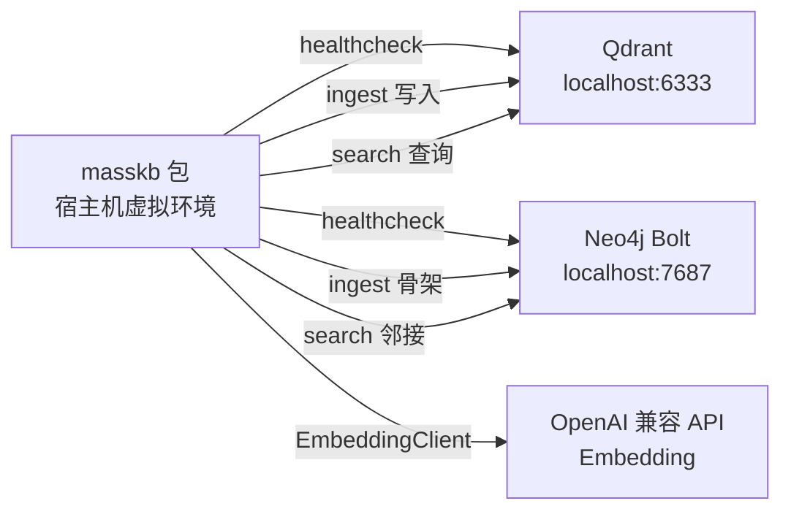

# MassKB

面向海量知识库的智能检索中间件：向量检索、知识图谱与智能代理。

*Intelligent retrieval middleware for large knowledge bases — vector search, knowledge graph, and an agent layer.*

[](https://github.com/bgwealth2027/masskb/actions/workflows/ci.yml)
[](LICENSE)
[](pyproject.toml)

MassKB 是一层检索中间件，目标是把向量检索、知识图谱和智能代理放在同一条调用链上。当前版本是 **0.1.0**。仓库里已有可安装的 Python 包、Qdrant 与 Neo4j 的 Docker Compose、离线单元测试，以及在 `main` 上运行的 GitHub Actions。UTF-8 的 `.txt` / `.md` 可以在本地切成稳定分块。`masskb ingest` 把这些分块写入 Qdrant，并在向量写成功后同步 Neo4j 文档骨架；`--dry-run` 只做预览。`masskb search` 用同一套 Embedding 模型做近邻检索，把命中的原文打成 JSON，并附上前后分块 id。人物/概念抽取、BM25、混合检索、RAG、REST API 和 Agent 仍未做。

## 目录

- [项目简介](#项目简介)
- [架构](#架构)
- [当前状态](#当前状态)
- [安装与运行](#安装与运行)
- [配置](#配置)
- [项目结构](#项目结构)
- [测试与持续集成](#测试与持续集成)
- [许可证](#许可证)

## 项目简介

本仓库交付的是 Python 库、命令行，以及依赖服务的 Compose 文件。三个组成部分的设计职责和 0.1.0 的实际范围如下：

| 组成部分 | 目标职责 | 本仓库里的落点 |
|----------|----------|----------------|
| 向量检索 | 对文本做语义相似度查找 | `VectorStore` 连接 Qdrant。入库写入 `masskb_chunks`；`search` 用同一 Embedding 模型做余弦近邻查询 |
| 知识图谱 | 保存文档与分块的骨架，并读取前后邻 | `GraphStore` 连接 Neo4j。健康检查只做 Bolt 连通性；入库 MERGE `Document` / `Chunk`，检索读取一跳 `NEXT_CHUNK` |
| 智能代理 | 用大模型改写查询、调度检索并组织回答 | 配置项已预留；没有对话客户端，也没有工具调用循环 |

向量由 OpenAI 兼容的 Embedding API 生成。`pyproject.toml` 的依赖是 `qdrant-client`、`neo4j`、`openai`、`python-dotenv`、`httpx`、`pydantic`，安装清单里没有 `sentence-transformers` 或 `torch`。本地切分不使用这些客户端。

## 架构

### 当前运行时

Docker Compose 只启动 Qdrant 和 Neo4j。Python 包跑在宿主机的虚拟环境里，直接访问本机端口。Embedding 请求发往 `LLM_BASE_URL`（默认 `https://api.openai.com/v1`）。健康检查不调用 Embedding API。`ingest --dry-run` 只在进程内切分本地文件，不访问外部服务。不带 `--dry-run` 的 `ingest` 会请求 Embedding API，把向量写入 Qdrant，再把该文档的骨架写入 Neo4j。`search` 会先请求 Embedding API，再在 Qdrant 里做近邻查询，然后按命中的 `chunk_id` 读取前后邻。Neo4j 读失败时，向量命中仍然输出。检索不写入 Qdrant。



| 组件 | 实现 | 说明 |
|------|------|------|
| Qdrant | `qdrant/qdrant:latest` | HTTP `6333`，gRPC `6334`；容器名 `masskb-qdrant` |
| Neo4j 5 | `neo4j:5` | Browser `7474`，Bolt `7687`；容器名 `masskb-neo4j`；Compose 会安装 APOC，业务代码尚未调用 |
| Embedding / LLM | OpenAI 兼容 HTTP API | `EmbeddingClient` 会请求 embeddings；`LLM_MODEL` 已读入配置，没有对应的对话调用 |
| 本地切分 | `masskb.ingest` | 空行分段，超长段按字符窗口切开。`ingest` 默认把分块写入 Qdrant；`--dry-run` 只预览 |
| 编排 | `RetrievalPipeline` | `ingest()` 先写向量再同步文档骨架；`search()` 做近邻检索并补前后邻；`healthcheck()` 汇总两个数据库的状态 |
| 部署 | `docker-compose.yml` | 数据卷：`qdrant_data`、`neo4j_data`、`neo4j_logs` |

### 目标架构图

设计图放在 [`docs/architecture/`](docs/architecture/README.md)，源文件是 draw.io，可用 [diagrams.net](https://app.diagrams.net/) 打开。这些图描述的是目标形态。图中的 REST API、BM25、混合检索、Agent 工具调用、应用容器和本地嵌入推理容器仍未落地；向量入库、文档骨架与向量查询以 [当前状态](#当前状态) 为准。

| 文件 | 图名 | 图里有什么 |
|------|------|------------|
| [01-总体架构.drawio](docs/architecture/01-总体架构.drawio) | 总体架构 | 检索层、图谱层、智能层，以及面向集成方的 SDK / REST |
| [02-数据流.drawio](docs/architecture/02-数据流.drawio) | 数据流 | 索引与图谱构建、查询路径。图中向量模型写作 bge-m3；代码默认模型是 `text-embedding-3-small` |
| [03-部署架构.drawio](docs/architecture/03-部署架构.drawio) | 部署架构 | Compose 网络。图中还有应用容器和可选嵌入容器；当前 Compose 文件没有这两项 |
| [04-集成与社区.drawio](docs/architecture/04-集成与社区.drawio) | 集成与社区 | 第三方经 SDK / API 集成，以及 Fork → PR → CI → 合并。SDK / REST 仍是规划；CI 已跑离线测试 |

## 当前状态

仓库里已有核心包、本地文本切分、Qdrant 向量入库与近邻检索、Neo4j 文档骨架、离线测试和 CI。人物与概念抽取、BM25、混合检索和 Agent 仍未做，下表只统计当前代码。

| 能力 | 状态 | 说明 |
|------|------|------|
| 环境配置 | 已实现 | `masskb.config.Settings` 读取仓库根目录 `.env` 与环境变量 |
| Embedding 客户端 | 已实现 | `EmbeddingClient.embed` / `embed_one`；占位 API Key 会直接报错，测试里客户端被 mock |
| Qdrant 封装 | 已实现 | 健康检查、建集合、批量 upsert、按 `doc_id` 删除、余弦近邻查询。查询不创建集合 |
| Neo4j 封装 | 已实现 | 健康检查仍是 `verify_connectivity` 与 `RETURN 1`。另有文档骨架的约束、MERGE、删除和前后邻读取 |
| 健康检查 CLI | 已实现 | `masskb healthcheck`、`python -m masskb`、`scripts/healthcheck.py` |
| 文本切分 | 已实现 | UTF-8 `.txt` / `.md` 切成带稳定 `doc_id`、`chunk_id` 和字符偏移的分块。`masskb ingest --dry-run` 只打印预览，不连接 Qdrant、Neo4j 或 OpenAI |
| 向量入库 | 已实现 | 默认集合 `masskb_chunks`，余弦距离，1536 维。写入前探测一次向量维度，不一致则中止且不写。重复运行按 point id 覆盖，并按 `doc_id` 删除该文档的过期点。每个文档的向量步骤成功后再同步 Neo4j |
| 离线测试与 CI | 已实现 | `tests/` 不连接真实服务；`.github/workflows/ci.yml` 在 `main` 推送和 Pull Request 上运行 |
| 向量检索 | 已实现 | `RetrievalPipeline.search` 与 `masskb search`。同一 Embedding 模型，返回分数、原文、路径、`chunk_id`、字符偏移，以及 `prev_chunk_id` / `next_chunk_id`。集合不存在或没有命中时得到空列表 |
| 文档骨架 | 已实现 | `Document`、`Chunk`、`HAS_CHUNK`、`NEXT_CHUNK`。重复运行使用 MERGE。图中不存正文和向量 |
| 实体抽取、混合检索、Agent、REST API | 未实现 | 只出现在 `docs/architecture/` 的设计图中。本阶段不做人物、概念或正文实体 |

## 安装与运行

需要 Python 3.10 或更高版本（CI 使用 3.12）以及 Docker Compose。Python 包不在容器里运行。本地切分预览不需要启动容器，也不需要 API Key。写入向量和执行检索时需要 Qdrant 和真实的 `OPENAI_API_KEY`。同步文档骨架和补前后分块时还需要 Neo4j；检索在 Neo4j 不可用时仍返回向量命中。

### 1. 克隆

```bash
git clone https://github.com/bgwealth2027/masskb.git
cd masskb
```

### 2. 启动 Qdrant 与 Neo4j

```bash
docker compose up -d
docker compose ps
```

| 服务 | 地址 |
|------|------|
| Qdrant HTTP | http://localhost:6333 |
| Qdrant gRPC | `localhost:6334` |
| Neo4j Browser | http://localhost:7474 |
| Neo4j Bolt | `bolt://localhost:7687` |

Compose 里的开发凭据是 `NEO4J_AUTH=neo4j/masskb-dev-pass`。这是本地示例密码，不要直接用于共享或生产环境。首次启动 Neo4j 时会拉取 APOC，健康检查的 `start_period` 是 40 秒。

### 3. 准备 `.env`

```bash
cp .env.example .env
```

至少把 `NEO4J_PASSWORD` 改成与 Compose 一致的 `masskb-dev-pass`。`.env.example` 里的 `your-neo4j-password-here` 和 `sk-your-api-key-here` 都只是占位符。没有真实 `OPENAI_API_KEY` 时，数据库健康检查仍然可以执行；`EmbeddingClient` 在真正请求前会拒绝占位 Key。`.env` 已被 `.gitignore` 排除。

### 4. 创建虚拟环境并安装

```bash
python3 -m venv .venv
source .venv/bin/activate
python -m pip install -U pip
python -m pip install -e ".[dev]"
```

`".[dev]"` 会安装本包，以及 `pytest` 和 `ruff`。只装运行依赖时可以使用 `pip install -e .` 或 `pip install -r requirements.txt`。

### 5. 健康检查

确认容器 `masskb-qdrant` 和 `masskb-neo4j` 已启动后执行：

```bash
python -m masskb healthcheck
```

安装完成后也可以直接运行 `masskb healthcheck`。不带子命令的 `python -m masskb` 同样进入健康检查。未执行可编辑安装时，可以用：

```bash
python scripts/healthcheck.py
```

Qdrant 与 Neo4j 都成功时，输出里各有一行 `[OK]`，进程退出码为 0，并附上 JSON 结果。任一数据库失败则退出码为 1。检查过程不会请求 Embedding API；Key 未配置时会多一行 `[INFO]`，这一行不改变退出码。

### 6. 本地切分与向量写入

`ingest` 把本地 UTF-8 文本切成稳定分块。加上 `--dry-run` 时只打印预览，不连接 Qdrant、Neo4j 或 OpenAI。不带 `--dry-run` 时，分块会经 `EmbeddingClient` 写入 Qdrant，再同步到 Neo4j。

只做预览：

```bash
python -m masskb ingest path/to/file.md --dry-run
python -m masskb ingest path/to/dir --dry-run
```

写入向量（需要已启动的 Qdrant，以及真实的 `OPENAI_API_KEY`）：

```bash
python -m masskb ingest path/to/file.md
python -m masskb ingest path/to/dir
```

- 只接受 UTF-8 的 `.txt` 与 `.md`。传入目录时会递归收集这两种文件，其他文件跳过。
- 先按空行分段，短段不合并。某一段超过字符窗口（默认 800）时，再按窗口切分，相邻块重叠 100 个字符。
- `doc_id` 是路径键的 SHA-256；`chunk_id` 是 `doc_id` 与字符起止偏移的 SHA-256。仓库内文件默认相对仓库根目录（可用 `--root` 指定别的根），因此同一文件在不同工作目录下得到相同 id。偏移相对换行已规范成 LF 的文本。
- 集合名是 `masskb_chunks`，距离是余弦，维度是 1536，对应默认模型 `text-embedding-3-small`。这些都是代码常量，不是新的环境变量。
- 写入前会用一句固定文本探测一次向量维度。维度不是 1536，或已有集合的维度、距离与约定不一致时，命令中止，不创建集合（探测失败时），也不 upsert、不删除。
- 每个分块的 point id 是 `chunk_id` 的 UUID5。同一分块再次写入会覆盖原点。文件重新切分后，该 `doc_id` 下不在本次 id 集合里的点会被删掉。
- 一次 ingest 只处理这次路径里出现的文档，不会删除目录中已经不存在的文件留在库里的旧点或旧骨架。
- 重复运行会重新请求 embedding。本阶段不按正文哈希跳过已写入的分块。
- 每个文档先完成 Qdrant 的 upsert 和按 `doc_id` 删除过期点，再在一个事务里 MERGE 文档骨架。图写入失败时，已经写入的 Qdrant 点保留，命令以非 0 退出。整次重新运行可以补上骨架。
- 节点是 `Document` 与 `Chunk`，关系是 `HAS_CHUNK` 和 `NEXT_CHUNK`（index 小的指向 index 大的）。图中不存正文和向量。重复运行使用 MERGE。窗口变化后，该 `doc_id` 下不在本次 id 里的 Chunk 会被删掉，前后关系按 index 重建。
- 空文件且集合不存在时不连接 Neo4j。集合已经存在时，会删掉该文档的点和骨架。
- 成功时输出文件数、分块数、短预览，以及 `collection`、`vector_size`、`upserted`、`graph_documents` 和 `graph_chunks`。这一步不做检索。

### 7. 向量检索

`search` 把查询文本交给与入库相同的 `EmbeddingClient`，再在集合 `masskb_chunks` 里做余弦近邻查询。有命中时按 `chunk_id` 读取 Neo4j 里的前后邻。结果以 JSON 打到标准输出，不做截断。这一步不写入 Qdrant。

```bash
python -m masskb search "质量"
python -m masskb search "质量" --top-k 3 --doc-id <doc_id>
```

- 默认返回 5 条。`--top-k` 必须是正整数。
- `--doc-id` 可选，只使用入库时已经建好的 `doc_id` 关键字索引。不传则搜索整个集合。
- 每条命中包含 `score`、`text`、`source`、`chunk_id`、`doc_id`、`index`、`start`、`end`，以及 `prev_chunk_id` 和 `next_chunk_id`。`score` 是 Qdrant 的余弦相似度，越大越近。`chunk_id` 是入库 payload 里的十六进制 id，不是 Qdrant 的 point id。首块、末块，或图里还没有这块时，对应邻接字段为 `null`。结果里不带邻块正文。
- 结果末尾有 `graph`，包含 `ok`、`skipped` 和 `error`。没有命中时不连接 Neo4j，`skipped` 为 `true`。Neo4j 补邻接失败时，`hits` 仍在，邻接字段为 `null`，`graph.ok` 为 `false`，进程退出码为 0。
- 查询使用当前的 `EMBEDDING_MODEL`，需要和入库时是同一个 1536 维模型。
- 集合不存在、集合里没有点，或过滤后没有命中时，`hits` 为空数组，进程退出码为 0。Qdrant 连不上、API Key 缺失或只是占位符、向量维度或集合配置与约定不符时，错误打到标准错误，退出码为 1。
- 空集合仍会先请求一次 embedding，因此缺 Key 和空库可以区分开。

### 8. 运行测试

```bash
python -m pytest
```

测试不连接 Qdrant、Neo4j，也不会访问 OpenAI。

## 配置

导入 `masskb.config` 时会加载仓库根目录的 `.env`，并把 `localhost`、`127.0.0.1` 和 `::1` 写入 `NO_PROXY` 与 `no_proxy`，避免本机 Docker 端口被系统 HTTP 代理截走。

| 变量 | 未设置时的代码默认值 | 说明 |
|------|----------------------|------|
| `QDRANT_URL` | `http://localhost:6333` | Qdrant HTTP 地址 |
| `NEO4J_URI` | `bolt://localhost:7687` | Neo4j Bolt 地址 |
| `NEO4J_USER` | `neo4j` | 与 Compose 中的用户名一致 |
| `NEO4J_PASSWORD` | 空字符串 | 本地 Compose 请填 `masskb-dev-pass` |
| `OPENAI_API_KEY` | 空字符串 | 以 `sk-your-` 开头的占位值视为未配置 |
| `LLM_BASE_URL` | `https://api.openai.com/v1` | OpenAI 兼容网关，Embedding 客户端使用 |
| `EMBEDDING_MODEL` | `text-embedding-3-small` | `.env.example` 中为注释项 |
| `LLM_MODEL` | `gpt-4o-mini` | 已读入配置；当前没有聊天或代理调用 |

向量入库和检索使用代码常量：集合名 `masskb_chunks`，余弦距离，维度 1536。文档骨架不新增环境变量。把 `EMBEDDING_MODEL` 换成非 1536 维的模型时，本次 ingest 会在写入前中止，`search` 也会在查询前中止。

## 项目结构

```
masskb/
├── docker-compose.yml          # Qdrant + Neo4j
├── pyproject.toml              # 包元数据、依赖、pytest / ruff 配置
├── requirements.txt            # 与 pyproject 运行依赖对齐的清单
├── .env.example                # 环境变量模板（不含可用密钥）
├── LICENSE                     # MIT
├── README.md
├── masskb/
│   ├── __init__.py             # 版本号 0.1.0
│   ├── __main__.py             # CLI：默认 healthcheck，另有 ingest 与 search
│   ├── ingest.py               # 本地切分：稳定 id 与字符偏移
│   ├── config.py               # Settings
│   ├── embeddings.py           # OpenAI 兼容 Embedding
│   ├── vector_store.py         # Qdrant：健康检查、向量写入与近邻查询
│   ├── graph_store.py          # Neo4j：健康检查与文档骨架
│   └── pipeline.py             # 编排；ingest 先向量后骨架，search 补前后邻
├── scripts/healthcheck.py      # 可在未安装包时运行
├── tests/                      # 离线单元测试
├── docs/architecture/          # 目标架构图（drawio）及说明
└── .github/
    ├── workflows/ci.yml        # 安装 .[dev] 并运行 pytest
    ├── CODEOWNERS
    ├── PULL_REQUEST_TEMPLATE.md
    └── ISSUE_TEMPLATE/
```

`.gitignore` 排除 `.env`、虚拟环境、`data/` 以及仓库根目录上的若干内部规划文档。`data/` 预留给不入库的本地语料，仓库本身不附带语料。

| 模块 | 职责 |
|------|------|
| `masskb/config.py` | 读取配置；判断 API Key 是否为占位符 |
| `masskb/embeddings.py` | 按返回的 `index` 排序后给出向量 |
| `masskb/vector_store.py` | 懒加载 `QdrantClient`（`prefer_grpc=False`）；建集合、批量 upsert、按 `doc_id` 删除、近邻查询 |
| `masskb/graph_store.py` | 懒加载 Bolt 驱动。健康检查只跑 `RETURN 1`；骨架写入使用 MERGE，检索读取一跳前后邻 |
| `masskb/pipeline.py` | 组装向量、图谱与 Embedding 客户端；`ingest` 在向量成功后同步骨架，`search` 补 `prev_chunk_id` / `next_chunk_id` |
| `masskb/ingest.py` | 本地切分；计算与工作目录无关的 `doc_id` / `chunk_id`。不创建外部客户端 |
| `masskb/__main__.py` | `masskb` 控制台脚本的入口：`healthcheck`、`ingest` 与 `search` |

## 测试与持续集成

| 测试文件 | 覆盖内容 |
|----------|----------|
| `tests/test_config.py` | 版本号、API Key 判断、环境变量、配置缓存、本机 `NO_PROXY` |
| `tests/test_embeddings.py` | 空输入、缺少真实 Key、客户端构造、按 index 排序 |
| `tests/test_stores.py` | 两个存储的健康检查成功、失败和 `close`；集合创建、配置不一致、分批 upsert、按 `doc_id` 删除、近邻查询；骨架约束、MERGE、删除和前后邻 |
| `tests/test_pipeline.py` | 离线健康检查、任一侧失败；向量写入的探测、维度中止、分批、重复写入与空文件；检索的空集合、过滤、维度与缺 Key；向量成功后再写图，图失败不回滚 Qdrant，邻接失败仍返回命中 |
| `tests/test_ingest.py` | 空文件、短文件、超长段、重叠、Markdown 标题、同一路径重复切分 id 不变 |
| `tests/test_cli.py` | CLI 退出码、默认子命令、帮助文本、`scripts/healthcheck.py`，dry-run 不创建外部客户端，不带 `--dry-run` 时的写入输出，以及 `search` 的 JSON（含前后 `chunk_id` 和 `graph`） |

工作流文件是 [`.github/workflows/ci.yml`](.github/workflows/ci.yml)。触发条件：

- 推送到 `main`
- 任意 Pull Request

作业在 `ubuntu-latest` 上使用 Python 3.12，执行 `pip install -e ".[dev]"` 和 `python -m pytest`。CI 不启动 Docker，也不运行 `ruff`。本地若要检查风格，可在安装开发依赖后执行 `ruff check`。

## 许可证

本项目采用 [MIT License](LICENSE)。

Copyright (c) 2026 Black God.
